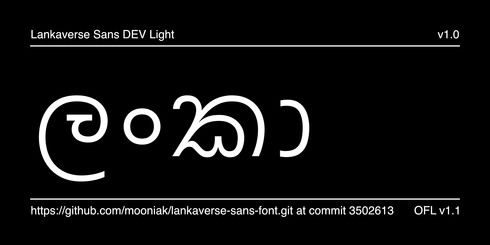
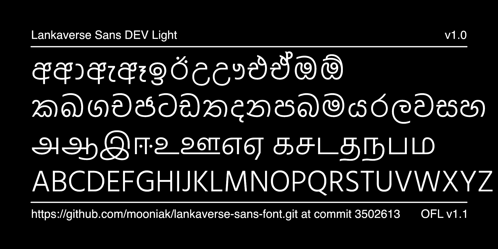

# Lankaverse Sans

[![Build][badge-build]][link-build]
[![Fontspector QA][badge-qa]][link-qa]
[![Release][badge-release]][link-release]

[badge-build]: https://github.com/mooniak/lankaverse-sans-font/actions/workflows/build.yaml/badge.svg?branch=dev
[badge-qa]: https://img.shields.io/badge/dynamic/json?url=https%3A%2F%2Fsrc.mooniak.com%2Flankaverse-sans-font%2Fbuild.json&query=%24.qa.pass_rate&suffix=%25&label=fontspector%20QA%20(dev%20build)&color=informational
[badge-release]: https://img.shields.io/github/v/release/mooniak/lankaverse-sans-font?label=release
[link-build]: https://github.com/mooniak/lankaverse-sans-font/actions/workflows/build.yaml
[link-qa]: https://src.mooniak.com/lankaverse-sans-font/reports/fontspector/fontspector-report.html
[link-release]: https://github.com/mooniak/lankaverse-sans-font/releases

Lankaverse Sans is a trilingual (Sinhala, Tamil, Latin) sans-serif typeface
for the Lankaverse Media project, maintained by [Pathum Egodawatta](https://pathumego.com/).

It is a derivative work based on **Hind**, **Hind Madurai**, and **Hind
Colombo** by the [Indian Type Foundry](https://www.indiantypefoundry.com/)
(design and engineering by Jyotish Sonowal, Manushi Parikh, Satya
Rajpurohit, and other ITF contributors). See [AUTHORS.txt](AUTHORS.txt) for
full attribution and [OFL.txt](OFL.txt) for the license and copyright
notices.

Licensed under the [SIL Open Font License, Version 1.1](OFL.txt).

The package [hindkit](https://github.com/itfoundry/hindkit) is required for `build.py` to run.
